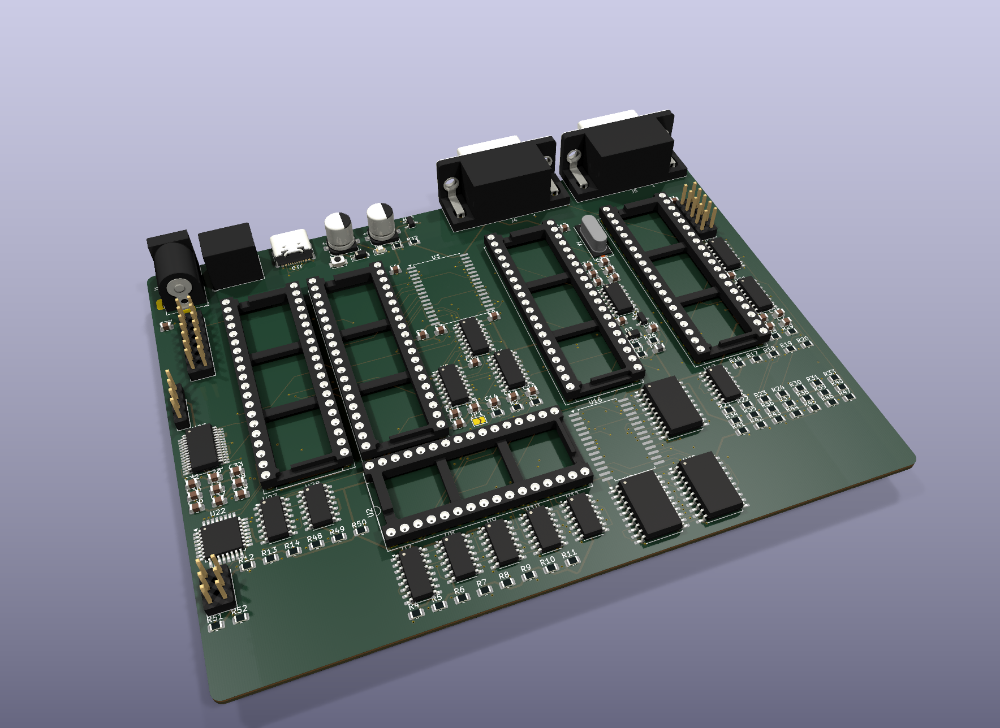
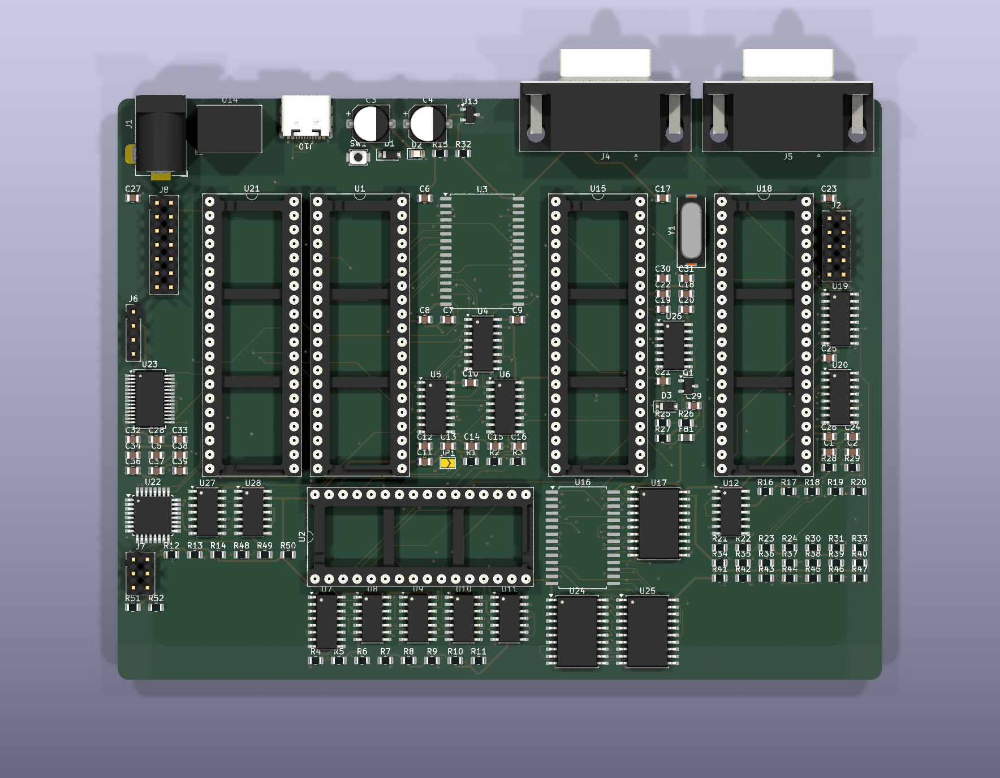
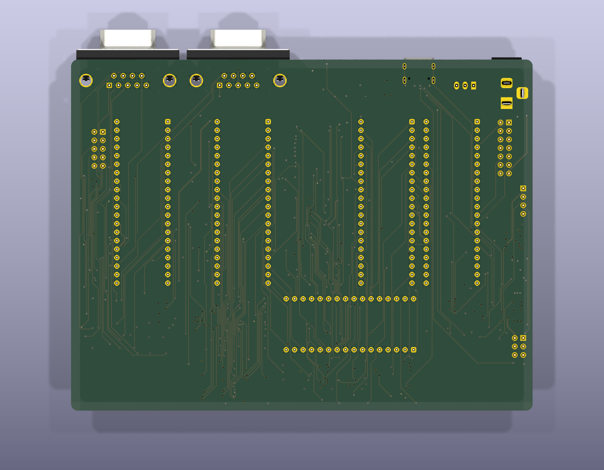
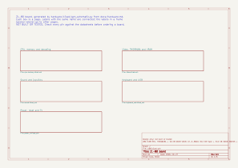
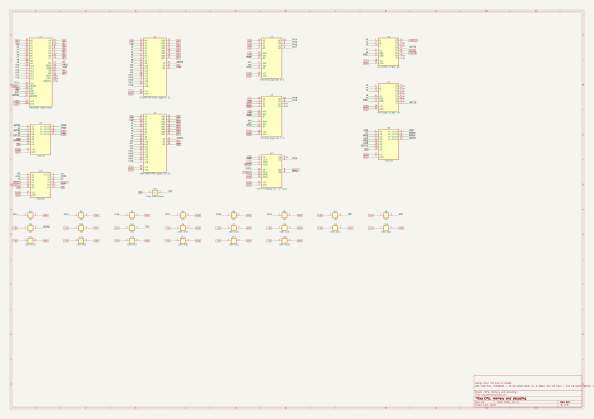
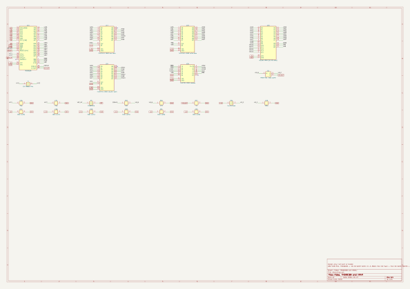
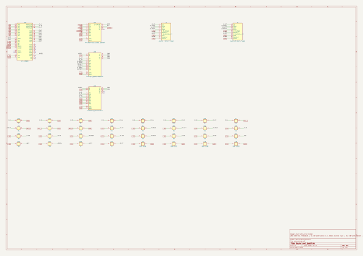
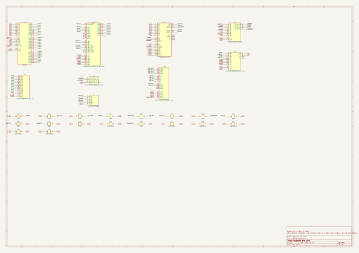
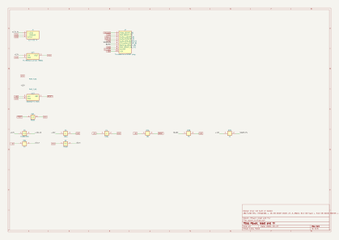

# Z80-retro-console

A browser-based Z80 fantasy console with its own programming language (**ZL**), a compiler that produces real Z80 machine code, and emulated display and sound chips. Everything is one self-contained file: `index.html`.

## Run it

Open `index.html` in any modern browser, or turn on GitHub Pages (Settings > Pages > Deploy from a branch > `main` / root) and open the page it gives you.

Press **Run** once so the browser allows sound.

## What is inside

- **CPU:** a full Z80 clocked at 4 MHz: every documented and undocumented instruction, all flags, interrupts (IM 0/1/2, NMI) and exact T-states, with 64 KB of memory. It passes the zexdoc and zexall instruction exercisers.
- **ZL language:** variables, `if`/`else`, `while`, `for`, arrays (1D and 2D), `gosub`/`goto`, `data` tables, sprites, text, and chip commands. It compiles to Z80 machine code.
- **Assembly listing:** every ZL line is shown with the Z80 instructions it produced, with comments.
- **Displays** (choose in the dropdown):
  - Virtual 64x64, 16 colors
  - SSD1306 OLED 128x64 (mono)
  - ST7735 TFT 128x160
  - Nokia 5110 PCD8544 84x48 (mono)
  - MC6845 CRTC text 80x25 and graphics
  - TMS9918A VDP 256x192: Graphics I and II, Text, Multicolor, 32 sprites, status flags
  - MC6847 VDG: text, semigraphics and 8 graphics modes
- **Sound:** AY-3-8910 or AY-3-8912 (pick one in the list) with 3 tone channels, noise, mixer, envelope (16 shapes), I/O port A, and port B on the AY-3-8910. There is also a simple `beep`.

## Examples

Pick one from the example list: alien attack game, Neon Rain (AY music), chip showcase (TMS9918A + AY), bouncing balls with 2D arrays, Game of Life, CRTC text scrolling, and more.

## ZL at a glance

```
x = 5                    ; variables are 8-bit
dim a 4                  ; arrays
data a 10 20 30 40       ; fill an array
for i = 0 to 4
  plot i i 11            ; x y color
end
label main
  key k                  ; arrows and fire as bits
  beep 40
  wait 1
  goto main
```

The reference section in the page lists every command.

## Notes

- Values are 8-bit (0 to 255).
- The TMS9918A and MC6847 keep pixels in their own memory layouts. `plot` works through helper ports, and the TMS9918A keeps its two-colors-per-8-pixels limit.
- Built with the help of Claude.

## Example programs

The example programs are stored as plain text in the `examples/` folder (`.zl` files). Paste one into the editor of the console to run it.

Other files: `cpc464/catch.bas` (a BASIC game for the Amstrad CPC464) and `docs/` (notes on how Snake and Boulder Dash work).

## Real hardware

`docs/hardware.md` is the plan for a real ZL-80 board: Z80, TMS9918A video, AY-3-8910 sound, 512 KB flash and 512 KB RAM, a PS/2 PC keyboard and two joysticks, and SCART output to a TV. Its KiCad schematic is in `hardware/kicad/`.



The board is 138 x 105 mm with 4 layers. It has not been built yet.

| Top | Bottom |
|---|---|
|  |  |

PCB layout: [all copper layers](hardware/images/pcb-layout.svg), [top](hardware/images/pcb-top-copper.svg), [inner signal layer In2](hardware/images/pcb-inner2-copper.svg), [bottom](hardware/images/pcb-bottom-copper.svg).

Schematic pages (click for full size):

| | |
|---|---|
| [](hardware/images/schematic-1-overview.svg) Overview | [](hardware/images/schematic-2-cpu-memory.svg) CPU, memory and decoding |
| [](hardware/images/schematic-3-video.svg) Video: TMS9918A and VRAM | [](hardware/images/schematic-4-sound.svg) Sound and joysticks |
| [](hardware/images/schematic-5-keyboard-usb.svg) Keyboard and USB | [](hardware/images/schematic-6-power-tv.svg) Power, reset and TV |

Pick **ZL-80 board (real hardware)** in the display list to run a program on an exact copy of that board: Z80 at 3.58 MHz, paged memory, a kernel ROM, only the real I/O ports, and the frame interrupt. A program that runs there is meant to run on the real board unchanged.

In that display, **ROM .bin** saves a 512 KB flash image for an EEPROM programmer and **HEX** saves the program as Intel HEX. **Send to board** sends the program to a real board over its USB port (Web Serial, Chrome or Edge), and **Send to emulator** sends it the same way to the emulated board. The real-board path has not been tried on hardware yet.
